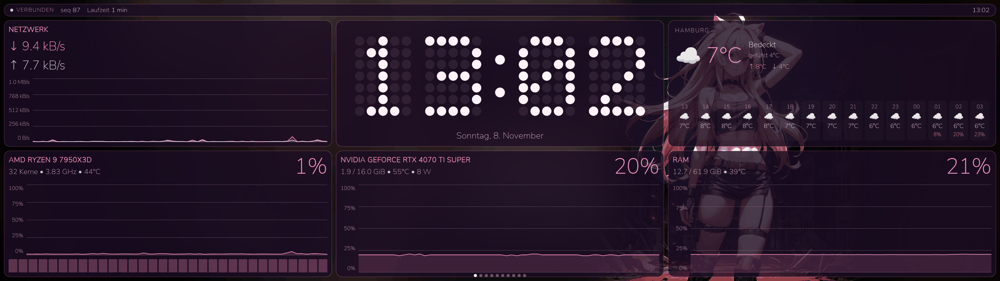
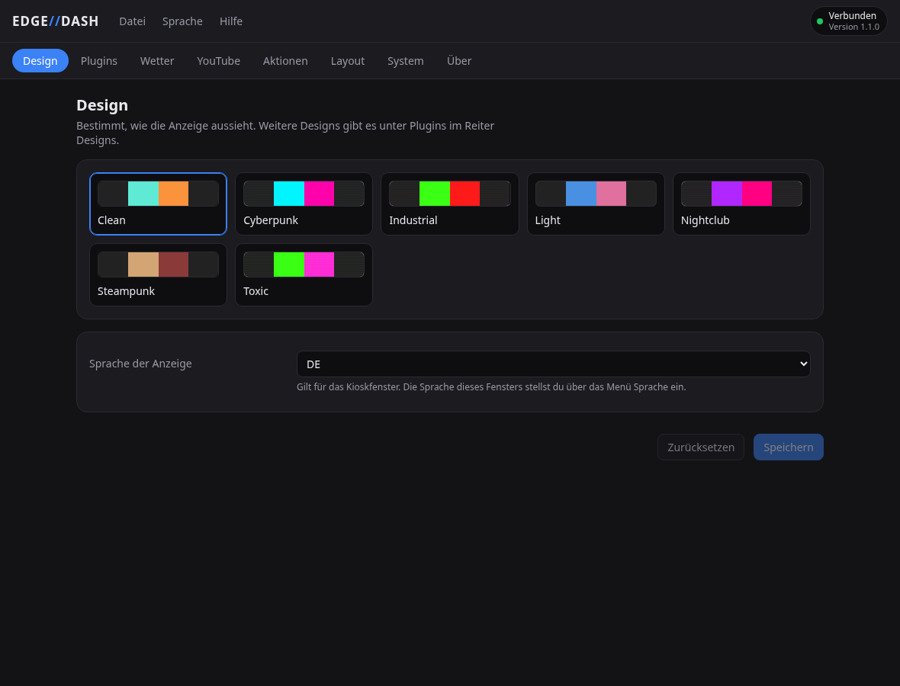
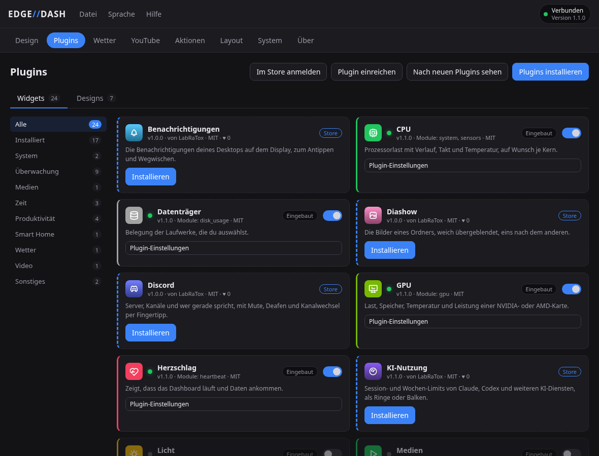

# Edge Dashboard

*[English version](README.md)*

[](https://discord.gg/2ckNnCZ4wq)



Ein Dashboard für das **Corsair Xeneon Edge 14,5"** (2560x720), das
Touchdisplay unter dem Monitor. Ein Kioskfenster füllt die Anzeige mit
Widgets voller Livedaten, und **EDGE//DASH**, eine eigene Desktop-Anwendung,
hält die Einstellungen.

## Wo läuft es?

**Unterstützt:** CachyOS, Arch Linux, Ubuntu 22.04 und 24.04, Debian 13,
Fedora 43 und Bazzite, jeweils x86_64.

- **Linux** mit systemd. Entwickelt und täglich im Einsatz auf
  [CachyOS](https://cachyos.org/) mit KDE Plasma und NVIDIA- oder AMD-Grafik.
  Andere Distributionen mit systemd sollten ebenso laufen.
- **Wayland oder X11.** Der Kiosk findet das Xeneon selbst, auch skaliert oder
  hochkant montiert. Andere Panels gehen ebenfalls, mit `--output`.
- **Desktops:**

| Sitzung | Kiosk nicht in der Fensterliste | Symbol in der Leiste | Start beim Anmelden |
|---|---|---|---|
| KDE Plasma 6 und 5 | ja | ja | ja |
| GNOME | unter X11; Wayland bietet dafür nichts | mit der AppIndicator-Erweiterung | ja |
| XFCE, Cinnamon, MATE, LXQt | unter X11 | ja | ja |
| Hyprland, Sway, i3 | Hyprland ja, Sway teilweise | ja, etwa Waybar | eine Zeile in deren Konfiguration, der Installer nennt sie |

Einzelheiten je Desktop stehen in [Einrichtung und Entwicklung](docs/setup.de.md#desktop-umgebungen).

## Was kann es?

- **Widgets mit Livedaten** für System, Schreibtisch und Tag, siehe die
  Tabelle unten.
- **Seiten zum Durchwischen**, jede ein Raster, das man im
  Einstellungsfenster anordnet.
- **Quick Actions**: ein Kachelraster wie beim Stream Deck, das Befehle
  ausführt, Adressen aufruft oder Programme startet, mit Ordnern und
  Live-Status.
- **Notizen**, lokal oder in Joplin, mit Ordnern, Suche und Checklisten zum
  Abhaken per Finger.
- **Designs**: cyberpunk, clean, steampunk, light, toxic, nightclub und
  industrial sind eingebaut, weitere kommen aus dem Store, auch mit
  Hintergrundbildern.
- **Ein Einstellungsfenster** in der Leiste und im Anwendungsmenü: Designs,
  Plugins, Layout, Quick Actions, Wetter. Änderungen stehen sofort auf der
  Anzeige, ohne Neustart.
- **Deutsch und Englisch.**



| Widget | Modul | Was es zeigt |
|---|---|---|
| `heartbeat` | `heartbeat` | Verbindung und Laufzeit |
| `clock` | `timezones` | Ortszeit oder eine andere Zone, analog oder digital in 22 Zifferblättern, Countdown mit Gong |
| `world_clock` | `timezones` | Bis zu sechs Zeitzonen nebeneinander |
| `cpu` | `system`, `sensors` | Auslastung je Kern mit Kurve, dazu die Temperatur |
| `ram` | `system`, `sensors` | Arbeitsspeicher mit Kurve, dazu die Temperatur |
| `network` | `system` | Durchsatz hoch und runter mit zwei Kurven |
| `gpu` | `gpu` | Auslastung, Speicher, Temperatur und Leistung einer NVIDIA- oder AMD-Karte |
| `sensors` | `sensors` | Alle Temperaturen aus hwmon als Tabelle |
| `sensor_focus` | `sensors` | Ein oder zwei gewählte Sensoren als Kurve oder Ring |
| `disk_usage` | `disk_usage` | Belegung je eingehängtem Datenträger |
| `top_processes` | `top_processes` | Die aufwendigsten Prozesse |
| `weather` | `weather` | Aktuelles Wetter und Vorhersage (Open-Meteo) |
| `media` | `media` | Steuerung und Cover des Players (MPRIS) |
| `youtube` | `youtube` | Videokacheln, ein Tippen öffnet das Videofenster |
| `quick_actions` | `quick_actions` | Das Kachelraster mit Befehlen, HTTP und Programmen, Ordnern und Status |
| `smart_lights` | `smart_lights` | Lampen von Govee und Tuya |
| `pomodoro` | keins | Pomodoro-Uhr und Stoppuhr |
| `notes` | `notes` | Notizen mit Ordnern, Suche, Anheften und Checklisten, lokal oder in Joplin |

## Plugins



Weitere Widgets und Designs kommen aus dem
[Plugin-Store](https://streamdeckstore.labratox.de), mit einem Klick unter
**Plugins** im Einstellungsfenster.

- Ein Plugin bringt mit, was es braucht. Python-Pakete installieren sich ohne
  besondere Rechte, Systempakete fragen einmal nach dem Passwort.
- Updates melden sich von selbst, **Alle aktualisieren** holt sie.
- Archive werden gegen die SHA-256-Prüfsumme des Stores geprüft, bevor etwas
  entpackt wird.
- Ein eigenes Widget oder Design lässt sich aus einer ZIP-Datei oder einem
  Ordner ausprobieren und im selben Fenster beim Store einreichen.

Wie man eins baut: [Ein Widget schreiben](docs/widgets.de.md) und
[Ein Theme schreiben](docs/themes.de.md).

## Wie wird es installiert?

**Jede Distribution**, mit einem Befehl. Er holt `uv`, falls es fehlt,
installiert das neueste Release und nennt fehlende Systembibliotheken samt
Befehl. Noch einmal ausgeführt aktualisiert er, die Einstellungen bleiben.

```bash
curl -fsSL https://raw.githubusercontent.com/LabRaTox/EdgeDisplayWidgets/main/scripts/get.sh | bash
```

**Arch und CachyOS**: das Paket aus dem
[neuesten Release](https://github.com/LabRaTox/EdgeDisplayWidgets/releases/latest),
dann kommen Updates über pacman. Oder selbst bauen aus `packaging/aur` mit
`makepkg -si`.

```bash
sudo pacman -U edge-dashboard-*-x86_64.pkg.tar.zst
systemctl --user enable --now edge-dashboard.service edge-kiosk.service
edge-dashboard-window-rule
```

**Aus dem Repository**, für die Entwicklung:

```bash
git clone https://github.com/LabRaTox/EdgeDisplayWidgets.git
cd EdgeDisplayWidgets
./scripts/install.sh
```

Danach steht das Dashboard auf der Anzeige, das Symbol ist in der Leiste und
das Einstellungsfenster im Anwendungsmenü. Logs:
`journalctl --user -u edge-dashboard -u edge-kiosk -f`.

## Mehr

- [Einrichtung und Entwicklung](docs/setup.de.md): Aufbau, Voraussetzungen je
  Modul, Desktops, der Installer im Einzelnen, die Anzeige, Entwicklung
- [Konfiguration](docs/configuration.de.md): `config.yaml`, Module, Quick
  Actions, smarte Lampen, Seiten
- [Ein Widget schreiben](docs/widgets.de.md) und [Ein Theme schreiben](docs/themes.de.md)

Fragen, Ideen und Layouts zum Herzeigen gehören auf den
[Discord-Server](https://discord.gg/2ckNnCZ4wq), Fehler und Wünsche in die
[GitHub-Issues](https://github.com/LabRaTox/EdgeDisplayWidgets/issues).

MIT, siehe [LICENSE](LICENSE).
