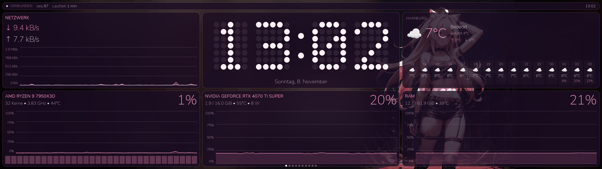
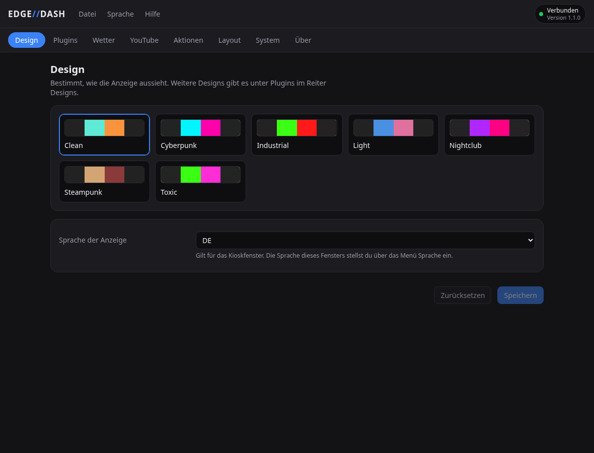
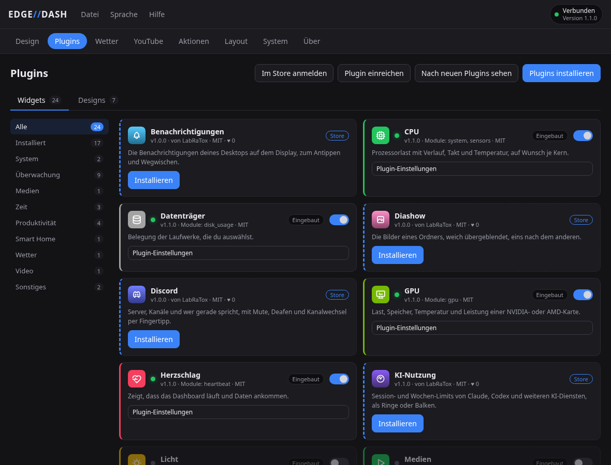

# Edge Dashboard

*[Deutsche Fassung](README.de.md)*

[](https://discord.gg/2ckNnCZ4wq)



A dashboard for the **Corsair Xeneon Edge 14.5"** (2560x720), the touch
display that sits under the monitors. A kiosk window fills the display with
live widgets, and **EDGE//DASH**, a separate desktop application, holds the
settings.

## Where it runs

**Supported:** CachyOS, Arch Linux, Ubuntu 22.04 and 24.04, Debian 13,
Fedora 43 and Bazzite, each on x86_64.

- **Linux** with systemd. Developed and used every day on
  [CachyOS](https://cachyos.org/) with KDE Plasma and an NVIDIA or AMD GPU.
  Other distributions with systemd should run as well.
- **Wayland or X11.** The kiosk finds the Xeneon by itself, also when it is
  scaled or mounted on its side. Other panels work too, with `--output`.
- **Desktops:**

| Session | Kiosk kept out of the task list | Tray icon | Starts at login |
|---|---|---|---|
| KDE Plasma 6 and 5 | yes | yes | yes |
| GNOME | on X11; Wayland offers no way | with the AppIndicator extension | yes |
| XFCE, Cinnamon, MATE, LXQt | on X11 | yes | yes |
| Hyprland, Sway, i3 | Hyprland yes, Sway partly | yes, e.g. Waybar | one line in their config, the installer names it |

Details for each desktop are in [Setup and development](docs/setup.md#desktop-environments).

## What it can do

- **Live widgets** for the system, the desk and the day, see the table below.
- **Pages you swipe through**, each a grid you arrange in the settings window.
- **Quick actions**: a Stream-Deck-like grid of tiles that run commands, call
  URLs or start programs, with folders and live status.
- **Notes**, locally or in Joplin, with folders, search and checklists you
  tick with a finger.
- **Themes**: cyberpunk, clean, steampunk, light, toxic, nightclub and
  industrial built in, more from the store, wallpapers included.
- **A settings window** in the tray and the application menu: themes, plugins,
  layout, quick actions, weather. Changes reach the display at once, without a
  restart.
- **English and German.**



| Widget | Backend module | Shows |
|--------|----------------|-------|
| `heartbeat` | `heartbeat` | Connection status and uptime |
| `clock` | `timezones` | Local time or another zone, analog or digital in 22 faces, countdown with a gong |
| `world_clock` | `timezones` | Up to six time zones side by side |
| `cpu` | `system`, `sensors` | Usage per core with a curve, and the temperature |
| `ram` | `system`, `sensors` | Memory usage with a curve, and the temperature |
| `network` | `system` | Download and upload with two curves |
| `gpu` | `gpu` | NVIDIA or AMD usage, VRAM, temperature, power |
| `sensors` | `sensors` | Every hwmon temperature as a table |
| `sensor_focus` | `sensors` | One or two chosen sensors as a curve or dials |
| `disk_usage` | `disk_usage` | Fill level per mount point |
| `top_processes` | `top_processes` | The busiest processes |
| `weather` | `weather` | Current weather and hourly forecast (Open-Meteo) |
| `media` | `media` | Player controls and album art (MPRIS) |
| `youtube` | `youtube` | Video tiles, a tap opens the video window |
| `quick_actions` | `quick_actions` | The tile grid: shell, HTTP and app tiles, folders, live status |
| `smart_lights` | `smart_lights` | Govee and Tuya lights |
| `pomodoro` | none | Pomodoro timer and stopwatch |
| `notes` | `notes` | Notes with folders, search, pinning and checklists, locally or in Joplin |

## Plugins



More widgets and themes come from the
[plugin store](https://streamdeckstore.labratox.de), with one click under
**Plugins** in the settings window.

- A plugin brings what it needs. Python packages install without special
  rights, system packages ask for the password once.
- Updates show up on their own, **Update all** fetches them.
- Archives are checked against the store's SHA-256 before anything is
  unpacked.
- Your own widget or theme can be tried from a zip or a folder, and
  submitted to the store from the same window.

How to build one: [Writing a widget](docs/widgets.md) and
[Writing a theme](docs/themes.md).

## Installation

**Any distribution**, with one command. It fetches `uv` if needed, installs
the newest release and names any missing system library with the command to
install it. Running it again updates, the settings stay.

```bash
curl -fsSL https://raw.githubusercontent.com/LabRaTox/EdgeDisplayWidgets/main/scripts/get.sh | bash
```

**Arch and CachyOS**: the package from the
[latest release](https://github.com/LabRaTox/EdgeDisplayWidgets/releases/latest),
so updates come through pacman. Or build it from `packaging/aur` with
`makepkg -si`.

```bash
sudo pacman -U edge-dashboard-*-x86_64.pkg.tar.zst
systemctl --user enable --now edge-dashboard.service edge-kiosk.service
edge-dashboard-window-rule
```

**From the repository**, for development:

```bash
git clone https://github.com/LabRaTox/EdgeDisplayWidgets.git
cd EdgeDisplayWidgets
./scripts/install.sh
```

Afterwards the dashboard is on the display, the tray icon is there and the
settings window is in the application menu. Logs:
`journalctl --user -u edge-dashboard -u edge-kiosk -f`.

## More

- [Setup and development](docs/setup.md): architecture, requirements per
  module, desktops, the installer in detail, the kiosk display, development
- [Configuration](docs/configuration.md): `config.yaml`, modules, quick
  actions, smart lights, pages
- [Writing a widget](docs/widgets.md) and [Writing a theme](docs/themes.md)

Questions, ideas and layouts to show off go to the
[Discord server](https://discord.gg/2ckNnCZ4wq), bugs and feature requests to
[GitHub issues](https://github.com/LabRaTox/EdgeDisplayWidgets/issues).

MIT, see [LICENSE](LICENSE).
