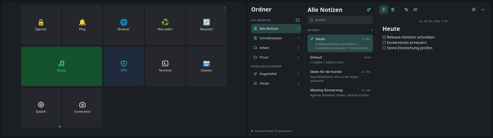
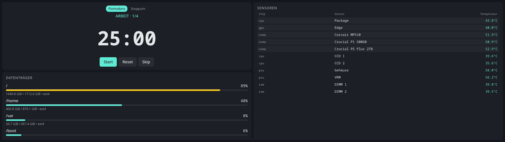

# Konfiguration

*[English version](configuration.md)*

Das Einstellungsfenster deckt all das ab. Diese Seite ist für alle, die
`config.local.yaml` von Hand bearbeiten oder wissen wollen, was ein Wert bewirkt.


Geladen wird in dieser Reihenfolge:

1. die Umgebungsvariable `$EDGE_CONFIG`, ein ausdrücklicher Pfad, nützlich für
   Tests
2. `config.local.yaml` im Projektverzeichnis, falls vorhanden; das ist nach dem
   Einzeiler `~/.local/share/edge-dashboard/app`. Beim Paket stattdessen
   `~/.config/edge-dashboard/config.yaml`
3. `config.yaml`, die mitgelieferte Vorlage

**Bearbeitet wird im Einstellungsfenster, nicht in der Datei.** Was dort
gespeichert wird, landet in `config.local.yaml`, die nicht in Git liegt. Die
eingecheckte `config.yaml` bleibt eine saubere Vorlage. Geschrieben wird
atomar, und die ersetzte Fassung bleibt als `config.local.yaml.bak` liegen.

## Oberste Ebene

```yaml
server:
  host: "127.0.0.1"    # Bindeadresse, localhost heißt nur diese Maschine
  port: 8765

logging:
  level: "INFO"        # TRACE | DEBUG | INFO | WARNING | ERROR | CRITICAL
  json: false          # true ergibt ein JSON-Objekt je Zeile, für journald

default_theme: "cyberpunk"
default_language: "auto"   # auto | en | de, gilt für die Anzeige

modules: { ... }       # je Modul, siehe unten
pages:   [ ... ]       # Seitenlayouts, siehe unten
```

Solange es an `127.0.0.1` gebunden ist, beantwortet das Backend nur Anfragen an
`127.0.0.1`, `localhost` oder `::1`. So kann eine Webseite, deren Domain auf
diesen Rechner umgebogen wurde (DNS-Rebinding), die API nicht auslesen.
Weitere Namen erlaubt `EDGE_ALLOWED_HOSTS=name1,name2` in der Umgebung des
Dienstes.

## Module

Jeder Schlüssel unter `modules:` entspricht dem `name` einer `Module`-Klasse.
Gemeinsam haben alle `enabled` und `interval`, alles Weitere reicht das
Backend an das Modul durch.

> Im Einstellungsfenster schaltet unter **Plugins** der Schalter auf der
> Karte eines Widgets dessen Module an und aus, und **Plugin-Einstellungen**
> zeigt für jedes Feld, das diese Module deklarieren, eine Eingabe: das
> Intervall und was das Modul selbst anbietet, etwa die API-Schlüssel der
> Lampen, `min_size_gb` und Einhängepunkte der Datenträger, die Zeilenzahl der
> Prozessliste, die Zeitgrenzen der Quick Actions oder den Speicherort der
> Notizen. Geheimnisse werden maskiert und nur überschrieben, wenn ein neuer
> Wert eingegeben wird. Das YAML unten erklärt,
> was die Felder bedeuten, es ist kein Ort, an dem man normalerweise
> schreibt.

```yaml
modules:
  heartbeat:
    enabled: true
    interval: 1.0          # die Verbindungsanzeige oben am Dashboard

  system:                  # CPU, RAM und Netzwerkzähler über psutil
    enabled: true
    interval: 1.0

  gpu:                     # GPU-Werte, NVIDIA über nvml, AMD über amdgpu
    enabled: true
    interval: 1.0

  sensors:                 # Temperaturen aus /sys/class/hwmon
    enabled: true
    interval: 2.0

  media:                   # MPRIS-Steuerung für Spotify, Browser, MPV
    enabled: true          # ohne Intervall: meldet sich bei Änderungen am Player

  weather:
    enabled: true
    interval: 600          # Open-Meteo empfiehlt mindestens zehn Minuten
    name: ""
    lat: 0
    lon: 0
    timezone: "auto"
    units: "metric"        # metric | imperial

  youtube:
    enabled: true
    interval: 3600         # oEmbed-Daten ändern sich selten
    entries:
      - "https://www.youtube.com/watch?v=dQw4w9WgXcQ"   # Video-Adresse
      - "fh-i7gw4Dwg"                                   # oder die reine ID
      - "https://www.youtube.com/playlist?list=PL..."   # oder eine Playlist

  disk_usage:
    enabled: true
    interval: 30
    min_size_gb: 1.0       # blendet Winzlinge wie /boot/efi aus
    # mounts: ["/", "/home"]    # optionale Auswahl, sonst alle echten Platten

  top_processes:
    enabled: true
    interval: 3
    limit: 6               # Anzahl der Zeilen

  notes:
    enabled: true
    interval: 5            # wie oft nach Änderungen von außen gesehen wird
    storage: local         # local | joplin
    joplin_token: ""       # freiwillig; leer: "Mit Joplin verbinden" in der Kachel fragt danach
    joplin_notebook: "Edge Dash"   # das Joplin-Notizbuch für Schnellnotizen
    joplin_port: 0         # 0: Joplin auf den Ports 41184 bis 41194 suchen
```

**Notizen in Joplin.** Die Joplin-Desktop-App stellt eine lokale API bereit,
sobald ihr Web-Clipper-Dienst eingeschaltet ist (Einstellungen → Web Clipper).
Mit `storage: joplin` liegt alles dort: Notizbücher werden zu Ordnern,
Unter-Notizbücher erscheinen als „Eltern › Kind“, Checklisten bleiben Markdown
(`- [ ]`) und lassen sich auf dem Display abhaken, Schnellnotizen landen im
Notizbuch aus `joplin_notebook`. Für die Verbindung braucht es einen Token,
entweder in den Plugin-Einstellungen eingetragen oder über **Mit Joplin
verbinden** in der Kachel angefordert und in Joplin bestätigt. Anheften kennt
Joplin nicht, welche Notizen angeheftet sind, merkt sich Edge Dash auf diesem
Rechner.

## Quick Actions

Ein **Kachelraster nach Art eines Stream Decks**. Jede Kachel führt einen
lokalen Befehl aus, schickt eine HTTP-Anfrage, startet ein Programm oder
öffnet einen Ordner mit weiteren Kacheln. Das Frontend kennt ausschließlich
undurchsichtige Kennungen; die eigentlichen Befehle, Adressen und HTTP-Header
bleiben in der Konfiguration des Backends und erreichen den Browser nie.
Befehle laufen als Argumentliste, ohne Shell dazwischen, also ohne Globbing,
ohne Einsetzen von Variablen, ohne Pipes.

Das Deck verteilt die Kacheln auf ein festes Raster aus `columns` mal `rows`
(voreingestellt 4 mal 3) und blättert, was nicht passt, auf weitere Seiten.
Kacheln dürfen mehrere Zellen einnehmen, eigene Farben tragen, auf einer
festen Zelle sitzen und einen Statuspunkt zeigen.

**Bearbeitet** wird das unter `Aktionen` im Einstellungsfenster: das Deck wird
als Raster gezeichnet, ein Klick wählt eine Kachel aus, rechts stehen Symbol,
Beschriftung, Art, Befehl oder Adresse, HTTP-Header, Rückfrage, Farben, Größe,
Position und die Statusabfrage. Kacheln lassen sich mit der Maus umsortieren,
ein Doppelklick öffnet einen Ordner, und `Ausführen` löst die Aktion aus, um
sie zu prüfen, ohne den Editor zu verlassen.



### YAML

```yaml
modules:
  quick_actions:
    enabled: true
    interval: 60             # die Liste ist statisch, der Takt frischt den Status auf
    timeout_seconds: 30      # Höchstlaufzeit je Aktion
    status_timeout_seconds: 8   # Höchstlaufzeit je Statusabfrage
    columns: 4               # Rasterbreite (1 bis 8)
    rows: 3                  # Rasterhöhe (1 bis 8), Überzähliges blättert
    actions:
      # Befehl als Argumentliste, keine Shell, keine Platzhalter.
      - id: lock
        label: "Sperren"
        icon: "🔒"            # Emoji, Text, oder "ti:<name>" für ein Tabler-Symbol
        kind: shell
        command: ["loginctl", "lock-session"]

      # confirm: true fragt vorher nach.
      - id: reboot
        label: "Neustart"
        icon: "🔄"
        kind: shell
        command: ["systemctl", "reboot"]
        confirm: true

      # Ein Programm starten. detach: true schickt es in eine eigene Sitzung
      # und kehrt sofort zurück, damit die Zeitgrenze es nicht abwürgt.
      - id: launch_firefox
        label: "Firefox"
        icon: "app:firefox"   # wird über /api/apps/icon/<name> aufgelöst
        kind: shell
        command: ["firefox"]
        detach: true

      # HTTP-Aktion, etwa an Home Assistant. Die Header bleiben im Backend.
      - id: lights_off
        label: "Licht aus"
        icon: "💡"
        kind: http
        method: POST
        url: "http://homeassistant.local:8123/api/services/light/turn_off"
        headers:
          Authorization: "Bearer DEIN_TOKEN"
        json:
          entity_id: "all"

      # Eigene Farben, feste Zelle, zwei Spalten breit, mit Statusabfrage.
      # `state` (on/off/unknown) steuert den Punkt auf der Kachel.
      - id: vpn
        label: "VPN"
        icon: "ti:shield-lock"
        kind: shell
        command: ["nmcli", "connection", "up", "vpn"]
        color: "#1e293b"       # Kachelhintergrund, hexadezimal
        text_color: "#38bdf8"  # Symbol und Beschriftung
        w: 2                   # zwei Zellen breit (1 bis 4)
        h: 1                   # eine Zelle hoch (1 bis 4)
        page: 0                # welche Deckseite
        x: 0                   # Spalte, ab 0 gezählt
        y: 1                   # Zeile, ab 0 gezählt
        status:                # die Abfrage verlässt das Backend nie
          kind: shell
          command: ["nmcli", "-t", "-f", "NAME", "connection", "show", "--active"]
          match: "^vpn$"       # trifft zu, also an; sonst aus; Fehler heißt unbekannt

      # Ein Ordner mit eigenem Unterdeck.
      - id: system
        label: "System"
        icon: "ti:settings"
        kind: folder
        tiles:
          - id: suspend
            label: "Bereitschaft"
            icon: "ti:moon"
            kind: shell
            command: ["systemctl", "suspend"]
```

Zu den Feldern:

- `icon`: Emoji oder Text, `ti:<name>` für ein mitgeliefertes
  [Tabler-Symbol](https://tabler.io/icons), `app:<name>` für das Symbol eines
  installierten Programms.
- `color` und `text_color`: nur hexadezimal (`#rgb` oder `#rrggbb`), ohne
  Angabe erbt die Kachel vom Design.
- `w` und `h`: Ausdehnung in Zellen (1 bis 4). `page`, `x` und `y` nageln die
  Kachel fest; ohne `x` und `y` rutscht sie in die nächste freie Zelle. Im
  Editor werden Spalte und Zeile ab 1 angezeigt, in der Datei ab 0 gezählt.
- `status`: eine freiwillige Abfrage (`shell` oder `http`). Mit `match` gilt
  an, wenn die Ausgabe passt, sonst aus; ohne `match` zählt der Erfolg (Ende
  mit 0, HTTP 2xx). Eine fehlgeschlagene Abfrage ergibt unbekannt. Zum
  Frontend geht nur der abgeleitete Zustand.
- `detach` (nur bei `shell`): startet und vergisst, in einer eigenen Sitzung.
  Für alles, was länger läuft als die Zeitgrenze, also für Programme mit
  Fenster.
- `label_size` und `icon_size`: Schriftgröße (10 bis 48) und Symbolgröße
  (16 bis 128) nur dieser Kachel, in Pixeln; ohne Angabe gilt die des Decks.

## Smarte Lampen

```yaml
modules:
  smart_lights:
    enabled: true
    interval: 30
    govee:
      # Schlüssel: Govee-Home-App, Profil, "Apply for API Key".
      # Kostenlos rund 10 000 Anfragen am Tag, weit mehr als dieses Widget braucht.
      api_key: "DEIN-GOVEE-SCHLUESSEL"
    tuya:
      # Deckt Smart Life, Tuya Smart, Antela und die meisten Tuya-Ableger ab.
      # Einrichtung auf https://iot.tuya.com:
      #   1. Anmelden und ein Cloud-Projekt anlegen, kostenlos
      #   2. Reiter Devices, "Link Tuya App Account", QR-Code mit Smart Life scannen
      #   3. Access ID und Access Secret aus "Authorization Key" kopieren
      #   4. Die UID des verknüpften Kontos steht nach dem Scannen dort
      client_id: "DEINE-TUYA-CLIENT-ID"
      secret:    "DEIN-TUYA-SECRET"
      uid:       "DEINE-TUYA-UID"
      region:    "eu"       # eu | us | cn | in, je nach Konto
```

Einen der beiden Blöcke leer lassen (`api_key: ""`) schaltet diesen Anbieter
ab. Das Widget zeigt dann einen Hinweis statt eines Fehlers.

## Seiten und Platzierung

Jede Seite ist ein CSS-Grid. `grid.columns` und `grid.rows` sind wörtliche
Werte für `grid-template-columns` und `grid-template-rows`. Jedes Widget
bekommt `col` und `row`, ab 1 gezählt, dazu wahlweise `colspan` und `rowspan`.

`variant` wählt eine der Darstellungen, die ein Widget anbietet. Ein Widget
deklariert sie in seinem Manifest (`variants` in `widgets/<id>.json`), das
Backend liest sie beim Durchsehen des Verzeichnisses, und der Layout-Editor
bietet genau diese zur Auswahl an. Ohne Angabe gilt die Standarddarstellung.

Die Messwert-Widgets (cpu, gpu, ram, network, sensors, disk_usage) kennen
`compact`: nur die Zahl und ihre Unterzeile. Gedacht für kleine Kacheln. Das
Diagramm wird dabei gar nicht erst geladen, kostet also weder Zeichenzeit noch
Speicher.

```yaml
pages:
  - id: main
    title: "Haupt"
    grid:
      # 1.66 / 1 / 1 / 1.66 entspricht etwa 800 / 480 / 480 / 800 auf 2560 Pixeln
      columns: "minmax(0, 1.66fr) minmax(0, 1fr) minmax(0, 1fr) minmax(0, 1.66fr)"
      rows: "32px 1fr 1fr"
    widgets:
      - { id: heartbeat, col: 1, row: 1, colspan: 4, rowspan: 1 }
      - { id: clock,     col: 1, row: 2 }
      - { id: cpu,       col: 2, row: 2 }
      - { id: gpu,       col: 3, row: 2 }
      - { id: media,     col: 4, row: 2, rowspan: 2 }
      - { id: weather,   col: 1, row: 3 }
      - { id: ram,       col: 2, row: 3 }
      - { id: network,   col: 3, row: 3 }

  - id: detail
    title: "Detail"
    grid:
      columns: "1fr 1fr"
      rows: "1fr 1fr"
    widgets:
      - { id: cpu,     col: 1, row: 1, variant: compact }
      - { id: gpu,     col: 2, row: 1, variant: compact }
      - { id: network, col: 1, row: 2 }
      - { id: sensors, col: 2, row: 2 }
```

Bequemer geht das unter `Layout` im Einstellungsfenster: Seiten als Reiter,
eine Vorschau im Seitenverhältnis der Anzeige, und daneben Spalte, Zeile und
Ausdehnung für jedes Widget.



---

[Einrichtung und Entwicklung](setup.de.md) · [Ein Widget schreiben](widgets.de.md) · [Ein Theme schreiben](themes.de.md) · [README](../README.de.md)
