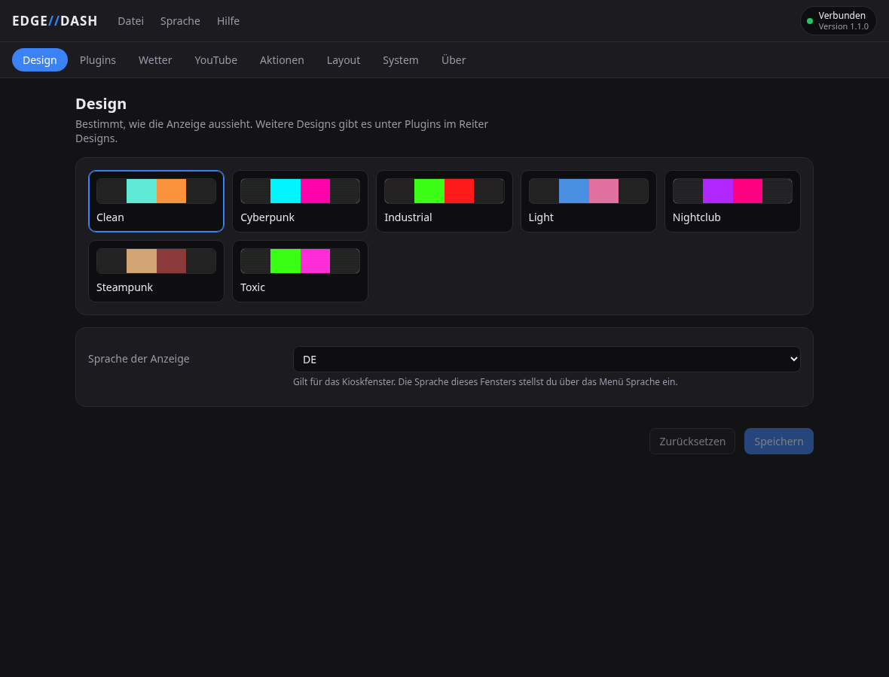
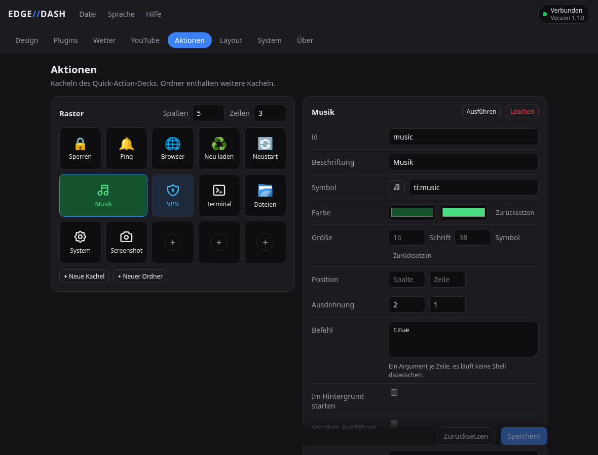

# Einrichtung und Entwicklung

*[English version](setup.md)*

Was die [README](../README.de.md) weglässt: wie die Teile zusammenspielen, was jede
Desktop-Umgebung braucht, der Installer im Einzelnen, die Anzeige und die Entwicklung.

## Aufbau

Drei Prozesse, jeder mit einer Aufgabe:

| Prozess | Was es ist | Läuft auf |
|---|---|---|
| `backend/` | FastAPI und der Modul-Hub, der einzige Schreiber der Konfiguration | virtuelle Umgebung des Projekts (`uv`) |
| `shell/qml_kiosk` | das Kioskfenster auf dem Xeneon | PySide6 des Systems, sonst eine eigene Umgebung |
| `gui/` | EDGE//DASH, das Einstellungsfenster | Tauri 2 und React |

Kiosk und Einstellungsfenster sind beide gewöhnliche Clients des Backends
über HTTP und einen WebSocket. Getrennt zu bleiben heißt: die Einstellungen
öffnen auch dann, wenn der Kiosk nicht läuft, und ein abgestürzter Renderer
reißt die Datensammlung nicht mit.

Im Backend sitzt auch das Symbol im Systemabschnitt der Leiste
(`backend/tray.py`, über D-Bus statt über ein GUI-Toolkit), und von dort wird
das Einstellungsfenster gestartet. Es ist der einzige der drei Prozesse, der
immer läuft, und damit der einzige sinnvolle Ort dafür.

Der Code folgt einem **Registry-Muster**: ein Widget besteht aus einer Quelle
im Backend (`backend/modules/<x>.py`, Unterklasse von `Module`, mit
`@register_module` versehen), einer Anzeige im Kiosk
(`shell/qml_kiosk/qml/widgets/<X>.qml`) und einem Manifest
(`widgets/<x>.json`), das es dem Layout-Editor bekannt macht. Die Daten
fließen vom Backend über den Hub und den WebSocket zu allen passenden
Widgets. Ein neues Widget braucht keine Änderung am Gerüst.

Widgets aus dem Store folgen demselben Muster, mit allen drei Teilen in einem
Ordner unter `~/.local/share/edge-dashboard/plugins/<id>/`. Das Backend lädt
ihre Module neben den eingebauten, der Kiosk findet ihre Anzeige dort.

Ein Modul liefert seine Daten auf einem Takt (`interval`), von sich aus, wenn
die Quelle sich meldet (`await self.emit(...)`, etwa bei MPRIS-Änderungen),
oder auf beide Arten. Unveränderte Daten werden nicht erneut gesendet, außer
das Modul setzt `dedupe = False`. Genau das tun die Module mit Messreihen,
denn eine Sparkline braucht auch dann einen Frame, wenn der Wert gleich
bleibt.

## Voraussetzungen

- **Linux mit systemd, x86_64.** Entwickelt auf Arch und CachyOS. Die
  Installation ist auf Ubuntu 22.04 und 24.04, Debian 13, Fedora 43, Bazzite
  und Arch geprüft. Andere Distributionen sollten ebenso laufen.
- **Wayland oder X11.** Das Kioskfenster sucht sich seine Anzeige selbst.

Um die meisten Bestandteile kümmert sich die Installation:

| Bestandteil | Wofür | Woher |
|---|---|---|
| [uv](https://github.com/astral-sh/uv) | Umgebungen und Abhängigkeiten, auch die Python-Pakete von Plugins | der Einzeiler installiert es |
| Python 3.13 | Laufzeit | `uv` holt es, falls es fehlt |
| PySide6 ab 6.10 | das Kioskfenster (Qt Quick) und der Videoplayer (Qt-WebEngine) | vom System, sonst von PyPI, siehe [Der Installer Schritt für Schritt](#der-installer-schritt-für-schritt) |
| WebKitGTK 4.1 | das Einstellungsfenster | System, der Installer nennt das Paket |
| systemd | die beiden Dienste | vorinstalliert |

Node und Rust braucht nur, wer das Einstellungsfenster selbst baut. Fehlen sie,
lädt der Installer das fertige Programm aus dem Release.

### Je nach Modul

| Modul | Braucht | Arch-Paket | Anmerkung |
|---|---|---|---|
| `gpu` | NVIDIA: Treiber mit nvml. AMD: der Kerneltreiber `amdgpu` | `nvidia-utils` für NVIDIA, für AMD nichts | Liest alle Karten beider Hersteller, auch integrierte Grafik. Ohne Karte meldet es das und stört nicht weiter. |
| `sensors` | gefülltes `/sys/class/hwmon` | `lm_sensors` | Einmal `sudo sensors-detect` laufen lassen. AMD-CPUs brauchen ein geladenes `k10temp`. |
| `media` | D-Bus-Sitzungsbus und ein MPRIS-Player | vorinstalliert | Funktioniert mit Spotify, MPV, VLC und Browsern mit MPRIS-Erweiterung. |
| `weather` | Internet | | Nutzt die kostenlose Open-Meteo-API ohne Schlüssel. |
| `youtube` | Internet | | Holt oEmbed-Daten, kein API-Schlüssel nötig. |
| `smart_lights` | Govee- oder Tuya-Konto | | Die Schlüssel werden je Anbieter eingetragen. |
| `quick_actions` | hängt von der Aktion ab | `libnotify` für `notify-send` und so weiter | Jede Aktion bringt ihren eigenen Befehl mit. |
| `timezones` | die IANA-Zeitzonendatenbank | `tzdata` (vorinstalliert) | Gelesen aus `/usr/share/zoneinfo`, aktualisiert mit dem System. |
| `notes` | lokal nichts; für Joplin die Desktop-App mit eingeschaltetem Web-Clipper-Dienst | `joplin-desktop` (AUR) oder das AppImage | Der Speicher wird in den Plugin-Einstellungen gewählt. Einmal über die Kachel verbinden und in Joplin bestätigen. |

## Desktop-Umgebungen

Entwickelt und benutzt unter KDE Plasma 6 auf Wayland. Was die anderen
brauchen, wichtig vor allem für Ubuntu, Debian und Fedora, die standardmäßig
GNOME mitbringen:

| Sitzung | Kiosk aus der Fensterliste | Symbol in der Leiste |
|---|---|---|
| **X11**, beliebige Umgebung | automatisch | ja |
| **KDE Plasma** (Wayland) | automatisch, per KWin-Regel | ja |
| **Hyprland** | ein Schnipsel zum Einbinden, der Installer schreibt ihn | ja, etwa über Waybar |
| **Sway / i3** | teilweise, siehe unten | ja, etwa über Waybar |
| **GNOME** (Wayland) | nicht möglich | braucht eine Erweiterung |
| **andere** (Wayland) | nicht automatisch | meistens ja |

Zwei Dinge hängen an der Umgebung, beide kosmetisch. Das Dashboard selbst
läuft überall.

**Der Kiosk soll nicht in der Fensterliste stehen.** Unter X11 verlangt das
Fenster das selbst, es setzt `_NET_WM_WINDOW_TYPE_UTILITY`, was jeder
Fenstermanager versteht. Wayland kennt keine Fenstertypen, dort muss der
Compositor es tun. Das erledigt `scripts/window-rule.sh`, und der Installer
ruft es auf:

```bash
./scripts/window-rule.sh
systemctl --user restart edge-kiosk    # gilt für danach geöffnete Fenster
```

Unter Plasma 6 und 5 schreibt es eine KWin-Regel, unter Hyprland einen
Schnipsel in der Syntax der installierten Version (`windowrule` ab 0.53, davor
`windowrulev2`), der aus `hyprland.conf` eingebunden werden muss (das Skript
sagt, wie), unter Sway eine `for_window`-Zeile. Sway kennt kein
skip-taskbar, dort wird das Fenster nur markiert, damit eine Leiste es
herausfiltern kann. GNOME auf Wayland bietet dafür nichts.

`EDGE_KIOSK_NO_FOCUS=1 ./scripts/window-rule.sh` lässt das Fenster zusätzlich
den Tastaturfokus verweigern, damit eine Berührung des Dashboards die Tastatur
nicht vom Hauptmonitor wegzieht. Standardmäßig aus, denn Wayland kann nicht
Zeigereingaben annehmen und Tastatur ablehnen: ohne Fokus ist jedes Textfeld
auf dem Kiosk nur noch lesbar, womit das Notiz-Widget sinnlos wird.

**Das Symbol in der Leiste** nutzt StatusNotifierItem über D-Bus, was Plasma,
Waybar, XFCE, Cinnamon und die meisten anderen umsetzen. GNOME braucht dafür
die Erweiterung *AppIndicator and KStatusNotifierItem Support*. Ohne das läuft
das Backend unverändert weiter, und das Einstellungsfenster öffnet man über
das Anwendungsmenü. Startet die Leiste nach dem Backend oder neu, bekommt sie
das Symbol, sobald sie da ist.

**Start beim Anmelden.** Die Dienste starten mit `graphical-session.target`,
das Plasma und GNOME erreichen. XFCE, Cinnamon, MATE, LXQt und andere tun das
nicht, deshalb schreibt das Einschalten des Autostarts zusätzlich
`~/.config/autostart/edge-dashboard-start.desktop`, das die Dienste dort
startet. Hyprland (ohne uwsm), Sway und i3 lesen beides nicht, der Installer
nennt die `exec-once`- oder `exec`-Zeile für deren Konfiguration.

## Der Installer Schritt für Schritt


1. Prüft, was vorhanden ist, und nennt zu allem Fehlenden das Paket: `uv`,
   eine systemd-Benutzersitzung und eine Leiste, die ein
   Symbol anzeigen kann.
2. Legt mit `uv sync` die virtuelle Umgebung aus `uv.lock` an, mit Python 3.13
   und ohne Entwicklungspakete, und richtet das PySide6 für den Kiosk ein.
3. Baut das Einstellungsfenster, falls `npm` und `cargo` da sind. Sonst lädt
   es das fertige Programm aus dem GitHub-Release. Klappt beides nicht,
   funktioniert der Rest trotzdem, nur die Oberfläche fehlt.
4. Installiert deren Symbol und Menüeintrag nach `~/.local/share` und
   frischt den Menü-Zwischenspeicher auf.
5. Sagt dem Compositor, dass das Kioskfenster nicht in die Fensterliste
   gehört, auf die Art, die dieser Compositor versteht.
6. Schreibt beide systemd-Units nach `~/.config/systemd/user/`, mit dem
   Projektpfad, dem Pfad zu `uv` und dem Python des Kiosks eingesetzt.
7. Aktiviert und startet sie und meldet, ob sie hochgekommen sind.

Ein erneuter Lauf ändert nichts, was schon stimmt. Nach einem `git pull` mit
neuen Python-Paketen muss er laufen, denn die Dienste aktualisieren die Umgebung
nicht selbst. Schalter:

```bash
./scripts/install.sh --no-build      # Einstellungsfenster nicht bauen
./scripts/install.sh --no-start      # einrichten, aber nichts starten
./scripts/install.sh --no-autostart  # jetzt starten, aber nicht beim Anmelden
```

Für das Kioskfenster nimmt der Installer das PySide6 **der Distribution**,
wenn es mindestens 6.10 ist und PyYAML im System-Python liegt. Diese Fassung
spielt auch H.264 und AAC. Sonst legt er `.venv-kiosk` mit PySide6 von PyPI an
(etwa 700 MB). Das ist unter anderem auf Ubuntu und Debian der Fall und
funktioniert ohne Handgriff am Python, nur die Systembibliotheken nennt der
Installer samt Befehl. YouTube läuft damit über VP9 und Opus; nur Videos, die
es ausschließlich in H.264 gibt, spielt diese Fassung nicht ab. Unter Arch
nennt der Installer stattdessen die Pakete für das System-PySide6.

## Danach

```bash
systemctl --user status edge-dashboard edge-kiosk         # was läuft
journalctl --user -u edge-dashboard -u edge-kiosk -f      # Protokoll mitlesen
systemctl --user stop   edge-dashboard edge-kiosk         # beide anhalten
```



## Das Kioskfenster von Hand starten

```bash
PYTHONPATH=$PWD/shell /usr/bin/python3 -m qml_kiosk.main
```

Hat der Installer `.venv-kiosk` angelegt, tritt das Python daraus an die Stelle
von `/usr/bin/python3`.

Es sucht die Anzeige mit der Auflösung 2560x720 oder dem Modellnamen Xeneon und
füllt sie. Taucht das
Display später auf als das Fenster, etwa nach einem Kaltstart, zieht das
Fenster von selbst um. `--help` listet die Schalter.

## Das Einstellungsfenster

Der Installer baut es oder lädt es aus dem Release. Für Entwicklung oder nach
Änderungen an der Oberfläche:

```bash
cd gui
npm install
npm run tauri dev                 # Entwicklungsserver auf http://localhost:5173
npm run tauri build -- --no-bundle # nur das Programm, mehr wird nicht gebraucht
npm run tauri build               # zusätzlich ein .deb
```

Aus dem Projektverzeichnis heraus braucht es kein Paket: das Programm unter
`src-tauri/target/release/` ist das, worauf Leistensymbol und Menüeintrag
zeigen. Deshalb übergibt der Installer `--no-bundle`. Der vollständige Bau
erzeugt zusätzlich ein `.deb`; der AppImage-Schritt scheitert derzeit unter
Arch in `linuxdeploy`.



Zwei Wege hinein, der Installer richtet beide ein: das **Symbol in der
Leiste** und der Eintrag **EDGE//DASH** im Anwendungsmenü. Ein Klick auf das
Symbol öffnet das Fenster, ein Rechtsklick gibt ein kleines Menü. Das Fenster
gibt es nur einmal, ein zweiter Aufruf holt das offene nach vorn. Findet es
kein Backend, startet es die Dienste selbst, statt nur zu melden, dass nichts
antwortet.

Das Symbol wird von `backend/brand.py` gezeichnet, demselben Code, den auch
die Leiste benutzt, damit beide nicht auseinanderlaufen. Nach einer Änderung
daran:

```bash
uv run python scripts/make-icon.py    # zeichnet alle Symboldateien neu
./scripts/install-desktop.sh          # kopiert sie ins Symbolthema
```

## Autostart

**System** im Einstellungsfenster schaltet den Autostart für beide Dienste
zusammen. Es schreibt dieselben Units wie der Installer und ruft
`systemctl --user enable` oder `disable` auf, mit Absicht ohne `--now`: der
Schalter regelt das nächste Anmelden und startet nicht das Backend neu, das
gerade die Anfrage beantwortet.

## Ohne Installer

```bash
uv sync                                # Umgebung anlegen
uv run python -m backend.main          # API auf http://127.0.0.1:8765
uv run pytest                          # rund 400 Tests, sollten alle grün sein
```

Für den Dienstbetrieb beide Units aus `systemd/` nach
`~/.config/systemd/user/` kopieren, dabei `__PROJECT_DIR__` durch den
absoluten Pfad des Projekts, `__UV__` durch `$(command -v uv)` und
`__KIOSK_PYTHON__` durch `/usr/bin/python3` oder das Python in `.venv-kiosk`
ersetzen, dann `systemctl --user daemon-reload` und aktivieren. Die
Kiosk-Unit nutzt absichtlich nicht die virtuelle Umgebung des Backends.

## Die Anzeige einrichten

Das Kioskfenster sucht sich seine Anzeige in dieser Reihenfolge:

1. `--output` oder `$EDGE_OUTPUT`, ein Anschlussname wie `DP-4`
2. der erste Bildschirm, dessen Auflösung zu `--width` mal `--height` passt,
   voreingestellt 2560x720. Gezählt wird in echten Pixeln und in beiden
   Richtungen, so wird auch eine skalierte oder hochkant montierte Anzeige
   gefunden
3. ein Bildschirm, dessen Modellname `XENEON` enthält
4. bei nur einem angeschlossenen Bildschirm dieser

Passt bei mehreren Bildschirmen keiner, verdeckt der Kiosk nicht den
Hauptmonitor. Er wartet in einem kleinen Fenster und geht in den Vollbildmodus,
sobald die Anzeige auftaucht. Wird sie abgezogen, verschwindet das Fenster, bis
sie wieder da ist.

```bash
edge-kiosk --output DP-4                 # Anschluss erzwingen
edge-kiosk --width 1920 --height 1080    # anderes Panel
edge-kiosk --url http://rechner:8765     # Backend woanders
edge-kiosk --windowed                    # normales Fenster, für Entwicklung
edge-kiosk --show-cursor                 # Mauszeiger sichtbar lassen
```

(`edge-kiosk` kommt mit dem Paket. Sonst steht es für den Aufruf aus
[Das Kioskfenster von Hand starten](#das-kioskfenster-von-hand-starten).)

Tastenkürzel hat das Kioskfenster keine, gestartet und beendet wird es über
systemd. Im Videofenster schließt Esc das Video. Der Mauszeiger ist
ausgeblendet, außer man gibt `--show-cursor` an.

### Das Fenster auf dem Xeneon

Qt setzt das Fenster direkt auf den ausgewählten Bildschirm. Ist der Xeneon
beim Start noch nicht da, wartet der Kiosk in einem Fenster und wechselt,
sobald er auftaucht.

Die Gruppe `[edge-dashboard-kiosk]` in `~/.config/kwinrulesrc` hält das
Fenster aus der Fensterliste heraus. Sie enthält keine Geometrie und wird von
`scripts/window-rule.sh` geschrieben.

## Sprachen

Die Texte liegen in `frontend/locales/<code>.json` und werden beim Start
geladen. Die Sprache der Anzeige ist der Konfigurationswert
`default_language` (`auto`, `en` oder `de`), einstellbar unter `Design`; bei
`auto` entscheidet `LANG` aus der Umgebung. Es ist bewusst ein Konfigurationswert
und keine Einstellung pro Gerät, denn das Einstellungsfenster ist eine eigene
Anwendung und kann den Speicher der Anzeige nicht beschreiben.

Das Fenster hat seine eigene Sprache unter `Sprache` und lädt dieselben
Textdateien vom Backend, damit Modulbeschriftungen nicht zweimal übersetzt
werden müssen.

Eine Sprache ergänzen: eine neue JSON-Datei neben `en.json` und `de.json`
legen und in `gui/src/i18n/index.ts` die Liste `SUPPORTED_LANGUAGES`
erweitern. Der Kiosk lädt die Datei über den Konfigurationswert und braucht
keine Liste.

## Entwicklung

```bash
uv sync                              # Umgebung anlegen
uv run python -m backend.main        # Server starten
uv run pytest                        # rund 400 Tests
uv run ruff check                    # Linter
uv run ruff format                   # Formatierer
```

Aufbau des Projekts:

```
backend/
  main.py             FastAPI, Lebenszyklus, Routen
  hub.py              Modul-Takt, WebSocket-Verteilung, Neuladen im Betrieb
  config.py           Pydantic-Schema, die einzige Wahrheit über die Struktur
  notes.py            Die Notizdatei (Ordner, Anheften)
  joplin.py           Joplin als Speicher der Notizen, über seine lokale API
  plugins.py          Installiert, lädt und entfernt Store-Plugins
  dependencies.py     Was Plugins mitbringen: Python- und Systempakete
  host.py             Startet andere Programme, an einer Stelle
  plugin_layout.py    Wo installierte Plugins liegen und was ihr Manifest sagt
  store.py            Der Store-Client: Katalog, Anmeldung, Upload
  tray.py             Symbol in der Leiste, über D-Bus
  autostart.py        Der Autostart-Schalter, schreibt und aktiviert die Units
  brand.py            Das App-Symbol, einmal gezeichnet für Leiste und Fenster
  modules/            Je Datei ein Modul
widgets/              Je Datei ein Widget-Manifest, das ist die Registrierung
frontend/             Was Kiosk und Einstellungsfenster von der Platte lesen
  player.html         Die Seite, die das Videofenster lädt
  css/themes/         Je Datei ein Design
  locales/            Je Datei eine Sprache
  vendor/             Tabler-Symbole, Schriften, Emoji-Datensatz
shell/
  qml_kiosk/
    qml/widgets/      Je Datei ein Widget, das ist die Anzeige
    qml/EdgeDash/     Die Bausteine, die installierte Widgets importieren
    views.py          Findet die QML-Datei zu einer Widget-id
    theme.py          Liest die Designs aus den CSS-Dateien
    bridge.py         WebSocket, Konfiguration, Texte, Symbole
gui/
  src/                EDGE//DASH, das Einstellungsfenster, React
  src-tauri/          Dessen Rahmen, Tauri 2
examples/plugins/     Zwei vollständige Store-Plugins: ein Widget und ein Design
config.yaml           Eingecheckte Vorlage
config.local.yaml     Nicht in Git, vom Einstellungsfenster geschrieben
systemd/              Vorlagen für die beiden Benutzer-Units
packaging/            Das Arch-Paket: PKGBUILD, Units und Startskripte für /usr
.github/workflows/    Baut das Einstellungsfenster für jedes Release
scripts/
  get.sh              Der Einzeiler: Installation und Update aus dem Release
  install.sh          Der Installer, erledigt alles Folgende mit
  fetch-settings-window.sh  Lädt das fertige Einstellungsfenster
  install-desktop.sh  Symbol und Menüeintrag des Einstellungsfensters
  window-rule.sh      Hält den Kiosk aus der Fensterliste, je Compositor
  make-icon.py        Zeichnet alle Symboldateien aus backend/brand.py
docs/
  setup.de.md         Diese Seite
  configuration.de.md Die Konfigurationsdatei im Einzelnen
  widgets.de.md       Anleitung: ein Widget schreiben
  themes.de.md        Anleitung: ein Theme schreiben
tests/                pytest, asyncio im Automatikmodus
```

---

[Konfiguration](configuration.de.md) · [Ein Widget schreiben](widgets.de.md) · [Ein Theme schreiben](themes.de.md) · [README](../README.de.md)
