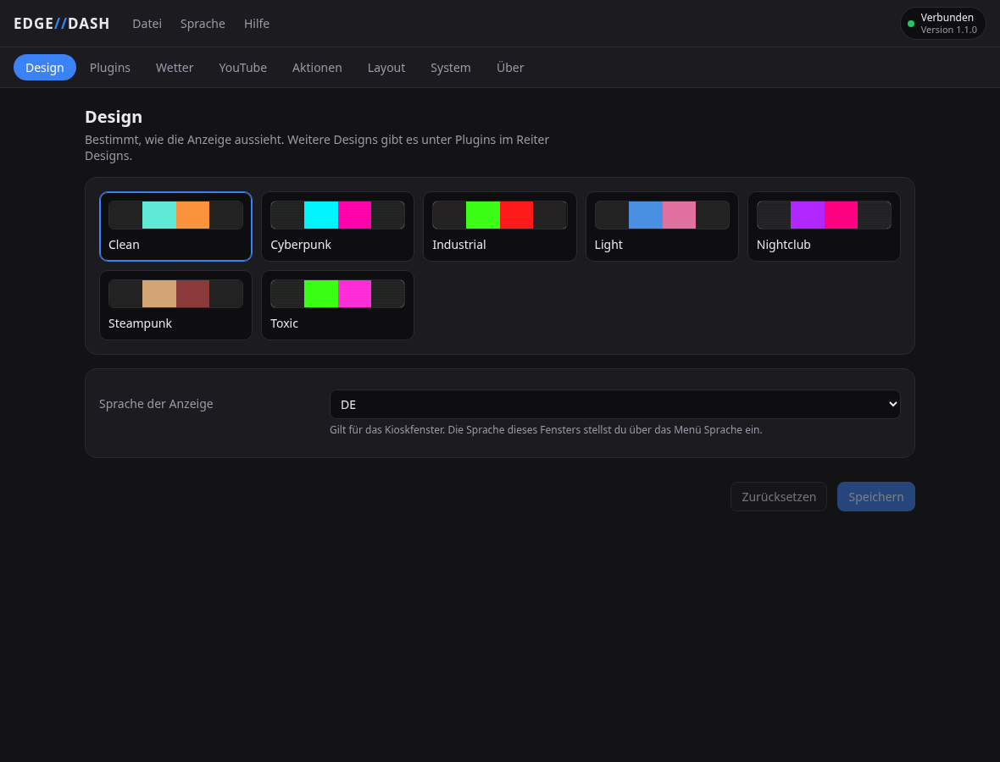
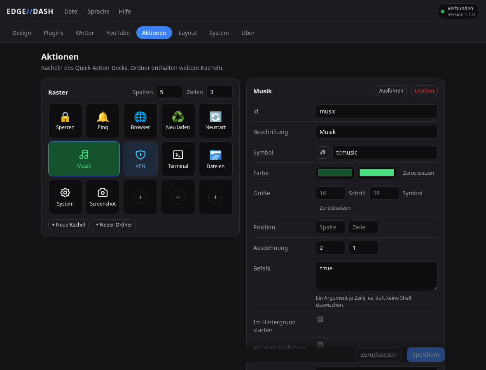

# Setup and development

*[Deutsche Fassung](setup.de.md)*

What the [README](../README.md) leaves out: how the parts fit together, what each
desktop needs, the installer in detail, the kiosk display and the development setup.

## Architecture

Three processes, each doing one thing:

| Process | What it is | Runs on |
|---------|-----------|---------|
| `backend/` | FastAPI + the module hub, the only writer of the config | project virtualenv (`uv`) |
| `shell/qml_kiosk` | the kiosk window on the Xeneon | the system PySide6, otherwise a virtualenv of its own |
| `gui/` | EDGE//DASH, the settings window | Tauri 2 + React |

The kiosk and the settings window are both plain clients of the backend over
HTTP and one WebSocket. Keeping them apart means the settings still open when
the kiosk is not running, and a crashed renderer never takes the data
collection with it.

The backend also carries the tray icon (`backend/tray.py`, over D-Bus rather
than a GUI toolkit) and starts the settings window from it. It is the only one
of the three that always runs, which makes it the only sensible place for it.

The code follows a **module registry pattern**. Each widget = one backend
producer (`backend/modules/<x>.py` subclassing `Module`, decorated with
`@register_module`) + one kiosk view (`shell/qml_kiosk/qml/widgets/<X>.qml`)
+ one manifest (`widgets/<x>.json`) that makes it known to the layout editor.
Data flows backend → hub → WebSocket → all matching widget instances. Adding
a widget requires no changes to the core scaffolding.

Widgets from the store follow the same pattern, with all three parts in one
folder under `~/.local/share/edge-dashboard/plugins/<id>/`. The backend loads
their modules next to the built-in ones, and the kiosk finds their views
there.

A module produces its data on a clock (`interval`), by pushing when its source
signals it (`await self.emit(...)`, as MPRIS property changes and systemd unit
state), or both. Unchanged payloads are not re-sent unless the module sets
`dedupe = False`, which the sample-stream modules do because a sparkline needs
a frame even when the value repeats.

## Requirements

### Operating system

- **Linux** with systemd, x86_64. Developed on Arch and CachyOS. The
  installation is checked on Ubuntu 22.04 and 24.04, Debian 13, Fedora 43,
  Bazzite and Arch; other distributions should run as well.
- Wayland or X11. The kiosk window finds its display by itself.

### Hard dependencies

The installation takes care of most of these:

| Component | Purpose | Comes from |
|-----------|---------|------------|
| [uv](https://github.com/astral-sh/uv) | virtualenvs and dependencies, also the Python packages of plugins | the one-line install fetches it |
| Python 3.13 | runtime | `uv` fetches it if missing |
| PySide6 6.10 or newer | the kiosk window (Qt Quick) and the video player (Qt WebEngine) | the system, otherwise PyPI, see [The installer step by step](#the-installer-step-by-step) |
| WebKitGTK 4.1 | the settings window | the system, the installer names the package |
| `systemd` | user services | preinstalled |

Node and Rust are needed only to build the settings window yourself. Without
them the installer downloads the finished program from the release.

### Optional dependencies (per module)

| Module | Needs | Arch package | Notes |
|--------|-------|--------------|-------|
| `gpu` | NVIDIA: driver + nvml. AMD: the kernel's `amdgpu` driver | `nvidia-utils` for NVIDIA, nothing for AMD | Reads every card of both makers, integrated graphics included. Falls back to "no graphics card detected", safe to leave enabled. |
| `sensors` | `/sys/class/hwmon` populated | `lm_sensors` | Run `sudo sensors-detect` once. AMD CPUs need `k10temp` autoloaded. |
| `media` | D-Bus session bus + an MPRIS player | (preinstalled) | Works with Spotify, MPV, browsers via the [MPRIS extension](https://github.com/F-Hauri/Plasma-Browser-Integration), VLC, etc. |
| `weather` | internet access |  | Uses Open-Meteo's free, key-less API. |
| `youtube` | internet access |  | Fetches oEmbed metadata; no API key needed. |
| `smart_lights` | Govee and/or Tuya account |  | API keys configured per provider (see below). |
| `quick_actions` | varies per action | `libnotify` for `notify-send`, etc. | Each action declares its own `command`. |
| `timezones` | the IANA zone database | `tzdata` (preinstalled) | Read from `/usr/share/zoneinfo`, updated with the system. |
| `notes` | nothing for local notes; for Joplin, its desktop app with the Web Clipper service on | `joplin-desktop` (AUR) or the AppImage | Storage is chosen in the plugin settings. Connect once from the tile and confirm in Joplin. |

## Desktop environments

Built and used on KDE Plasma 6 (Wayland). What the other environments need,
which matters most on Ubuntu, Debian and Fedora, where GNOME is the default:

| Session | Kiosk out of the task list | Tray icon |
|---|---|---|
| **Any X11 session** | automatic | yes |
| **KDE Plasma** (Wayland) | automatic, a KWin rule | yes |
| **Hyprland** | a snippet to source, the installer writes it | yes (Waybar and others) |
| **Sway / i3** | partly, see below | yes (Waybar and others) |
| **GNOME** (Wayland) | not possible | needs an extension |
| **Others** (Wayland) | not automatic | usually yes |

Two things are environment-specific, and both are cosmetic. The dashboard
itself runs everywhere.

**Keeping the kiosk out of the task manager.** On X11 the window asks for this
itself: it sets `_NET_WM_WINDOW_TYPE_UTILITY`, which every window manager
understands, so an X11 session needs no configuration at all. Wayland has no
equivalent, because xdg-shell knows no window types, so the compositor has to
be told instead. `scripts/window-rule.sh` does that, and the installer runs it:

```bash
./scripts/window-rule.sh
systemctl --user restart edge-kiosk    # applies to windows opened afterwards
```

It writes a KWin rule on Plasma 6 and 5, a window rule snippet on Hyprland
(in the syntax of the installed version, `windowrule` from 0.53 on and
`windowrulev2` before; it has to be sourced from `hyprland.conf`, the script
says so), and a `for_window` line for Sway. Sway has no skip-taskbar flag as such, so there the window is
marked and a bar can filter it. GNOME under Wayland offers no way at all; the
window will appear in the overview.

`EDGE_KIOSK_NO_FOCUS=1 ./scripts/window-rule.sh` additionally makes the kiosk
refuse the keyboard focus, so touching the dashboard leaves the keyboard where
it was. Off by default, because Wayland offers no way to take pointer input
while refusing the keyboard: without focus every text field on the kiosk is
read-only, which makes the notes widget pointless.

**The tray icon** uses StatusNotifierItem over D-Bus, which Plasma, Waybar,
XFCE, Cinnamon and most others implement. GNOME needs the *AppIndicator and
KStatusNotifierItem Support* extension. Without any of it the backend runs
unchanged and the settings window still opens from the application menu. A
panel that starts after the backend, or restarts, gets the icon as soon as it
is there.

**Starting at login.** The services start with `graphical-session.target`,
which Plasma and GNOME reach. XFCE, Cinnamon, MATE, LXQt and others do not,
so enabling the autostart also writes
`~/.config/autostart/edge-dashboard-start.desktop`, which starts the services
there. Hyprland (without uwsm), Sway and i3 read neither; the installer prints
the `exec-once` or `exec` line to add to their config.

## The installer step by step

1. Checks what is present and names the package for anything missing:
   `uv`, a systemd user session and a panel that can show a tray icon.
2. Runs `uv sync` to create `.venv/` from `uv.lock`, on Python 3.13 and without
   the development packages, then sets up the kiosk's PySide6.
3. Builds the settings window, if `npm` and `cargo` are there. Otherwise it
   downloads the finished program from the GitHub release. If neither works,
   everything else still runs, only the settings UI is missing.
4. Installs its icon and menu entry into `~/.local/share`, and refreshes the
   menu cache.
5. Tells the compositor to keep the kiosk window out of the task list, in
   whatever way that compositor understands (see
   [Desktop environments](#desktop-environments)).
6. Renders both systemd units into `~/.config/systemd/user/`, with the project
   path, the `uv` path and the kiosk's Python baked in.
7. Enables and starts them, then reports whether they came up.

Re-running is idempotent. It has to run after a `git pull` that brings new
Python packages, because the services do not update the virtualenv themselves.
Options:

```bash
./scripts/install.sh --no-build      # skip building the settings window
./scripts/install.sh --no-start      # install, but do not start anything
./scripts/install.sh --no-autostart  # start now, but not at the next login
```

For the kiosk window the installer takes the **distribution's** PySide6 if it
is 6.10 or newer and PyYAML is in the system Python. That build also plays
H.264 and AAC. Otherwise it creates `.venv-kiosk` with PySide6 from PyPI (about
700 MB). That is the case on Ubuntu and Debian among others and needs no work
on Python, the installer only names the system libraries, with the command.
YouTube plays over VP9 and Opus then; only videos that exist in H.264 alone
do not play in this build. On Arch the installer names the packages for the
system PySide6 instead.

## Afterwards

```bash
systemctl --user status edge-dashboard edge-kiosk         # what is running
journalctl --user -u edge-dashboard -u edge-kiosk -f      # live logs
systemctl --user stop   edge-dashboard edge-kiosk         # stop both
```



## Launching the kiosk by hand

```bash
PYTHONPATH=$PWD/shell /usr/bin/python3 -m qml_kiosk.main
```

If the installer created `.venv-kiosk`, use the Python in there in place of
`/usr/bin/python3`.

It picks the output matching the Edge's native `2560×720` and fills it. If
the display appears later than the window (a cold boot), the window moves over
by itself when it shows up. `--help` lists the overrides; see
[Kiosk display setup](#kiosk-display-setup).

## Settings window

The installer builds it or downloads it from the release. These are the commands behind that, for development
or for a rebuild after changing the UI:

```bash
cd gui
npm install
npm run tauri dev                 # dev server on http://localhost:5173
npm run tauri build -- --no-bundle # just the binary, which is all that is used
npm run tauri build               # additionally a .deb (and an AppImage)
```

Needs Node ≥ 20, Rust, and `webkit2gtk-4.1`. Running from the checkout needs
no bundle: the binary in `src-tauri/target/release/` is what the tray and the
menu entry point at, which is why the installer passes `--no-bundle`. The full
build also produces a `.deb`; its AppImage step currently fails in
`linuxdeploy` on Arch.

The window talks to the same backend over HTTP, and nothing about it is
required for the display to run. It can also be opened as a plain page during
development, which is what the dev server is for.



There are two ways in, and the installer sets up both: the **tray icon** and
the **EDGE//DASH entry in the application menu**. A click on the tray opens
the window, a right click gives a small menu. The window is a single instance,
so opening it again brings the existing one forward instead of stacking up
another. Finding no backend, it starts the services itself rather than only
reporting that nothing answers.

The icon and the menu entry come from `scripts/install-desktop.sh`. Without
them a task manager has no `.desktop` file to match the window's app id
(`edgedash`) against and shows a question mark instead of an icon:

```bash
./scripts/install-desktop.sh    # into ~/.local/share, no root needed
```

The icon itself is drawn by `backend/brand.py`, the same code the tray uses,
so the two cannot drift apart. After changing it:

```bash
uv run python scripts/make-icon.py    # re-renders every icon file
./scripts/install-desktop.sh          # copies them into the icon theme
```

The icon needs the settings window to have been built, and the tray starts the
binary it finds, in this order:

1. `$EDGE_GUI_BINARY`
2. `/usr/bin/edgedash`, `/usr/local/bin/edgedash` (installed from the `.deb`)
3. `gui/src-tauri/target/release/edgedash`, then the debug build
4. `edgedash` anywhere on `$PATH`

Without a panel that speaks StatusNotifierItem, or without a session bus at
all, the tray is skipped and the backend runs on unchanged. `EDGE_TRAY=0` in
the unit turns it off deliberately.

## Autostart

**System** in the settings window switches the autostart for both user units
at once. It writes the same units `scripts/install.sh` renders and runs
`systemctl --user enable`/`disable` on them, deliberately without `--now`, so
the switch governs the next login and never restarts the backend that is
answering the request.

## Manual install (without the script)

```bash
uv sync                                # install deps into ./.venv
uv run python -m backend.main          # API on http://127.0.0.1:8765
uv run pytest                          # ~400 tests, should pass clean
```

To run as a service without the installer, copy both units from `systemd/`
into `~/.config/systemd/user/`, replacing `__PROJECT_DIR__` with the absolute
path of the checkout, `__UV__` with `$(command -v uv)` and `__KIOSK_PYTHON__`
with `/usr/bin/python3` or the Python in `.venv-kiosk`, then
`systemctl --user daemon-reload` and enable them. The kiosk unit deliberately
does not use the backend's virtualenv.

## Kiosk display setup

The kiosk window picks its output itself, in this order:

1. `--output` / `$EDGE_OUTPUT`: a connector name, e.g. `DP-4`.
2. The first screen whose resolution matches `--width × --height`
   (default `2560×720`), counted in device pixels and either way round, so
   a scaled output or a panel mounted on its side is found too.
3. A screen whose model name contains `XENEON`.
4. With only one screen connected, that one.

With several screens and none of them matching, the kiosk does not cover the
main monitor. It waits in a small window and goes fullscreen as soon as the
display appears. When the display is unplugged, the window hides until it is
back.

```bash
edge-kiosk --output DP-4                 # force a connector
edge-kiosk --width 1920 --height 1080    # different panel
edge-kiosk --url http://my-host:8765     # remote backend
edge-kiosk --windowed                    # a normal window, for development
edge-kiosk --show-cursor                 # keep the mouse pointer visible
```

(`edge-kiosk` comes with the package. Otherwise it stands for the command in
[Launching the kiosk by hand](#launching-the-kiosk-by-hand).)

The kiosk window has no keyboard shortcuts; systemd starts and stops it. In
the video window, Esc closes the video. The cursor is hidden unless
`--show-cursor` is given.

### The window on the Xeneon

Qt places the window directly on the screen we picked. If the Xeneon is not
there yet at startup, the kiosk waits in a window and moves over once it
appears.

The `[edge-dashboard-kiosk]` group in `~/.config/kwinrulesrc` keeps the window
out of the task list. It carries no geometry and is written by
`scripts/window-rule.sh`.

## Languages

UI strings live in `frontend/locales/<code>.json`, read at boot by the kiosk
and by the settings window. The display's language is the config value
`default_language` (`auto` | `en` | `de`), set in the settings window under
`Design`; `auto` falls back to `LANG` from the environment. It is a config
value rather than a per-device preference because the settings window is a
separate application and cannot write the display's own storage.

The window has its own language under `Language`, and pulls the same locale
files from the backend so module labels need no second translation.

Adding a language: drop a new JSON file alongside `en.json` / `de.json` and
extend `SUPPORTED_LANGUAGES` in `gui/src/i18n/index.ts`. The kiosk loads the
file named by the config value and needs no list.

## Development

```bash
uv sync                              # set up .venv
uv run python -m backend.main        # dev server with auto-restart via uvicorn flags
uv run pytest                        # ~400 tests
uv run ruff check                    # lint
uv run ruff format                   # format
```

Project layout:

```
backend/
  main.py             FastAPI app, lifespan, routes
  hub.py              Module runner, WebSocket fanout, hot-reload
  config.py           Pydantic schema (single source of truth)
  notes.py            The notes file (folders, pinning)
  joplin.py           Joplin as the notes store, over its local API
  plugins.py          Installs, loads and removes store plugins
  dependencies.py     What plugins bring along: Python and system packages
  host.py             Starts other programs, from one place
  plugin_layout.py    Where installed plugins live and what their manifest says
  store.py            The plugin store client: catalog, sign-in, upload
  tray.py             Tray icon (StatusNotifierItem over D-Bus)
  autostart.py        The autostart switch, writes and enables the units
  brand.py            The app icon, drawn once for the tray and the window
  modules/            Module subclasses, one file per backend producer
widgets/              One manifest per widget; the file is the registration
frontend/             What the kiosk and settings window read off disk
  player.html         The page the video window loads
  css/themes/         One file per theme
  locales/            One JSON file per language
  vendor/             Tabler icons, fonts, emoji data set
shell/
  qml_kiosk/          The kiosk window (QML, system Python)
    qml/widgets/      One file per widget; this is the view
    qml/EdgeDash/     The building blocks installed widgets import
    theme.py          Reads the themes out of the CSS files
    bridge.py         WebSocket, config, strings, icons
gui/
  src/                EDGE//DASH, the settings window (React)
  src-tauri/          Its window frame (Tauri 2)
examples/plugins/     Two complete store plugins: a widget and a theme
config.yaml           Committed template
config.local.yaml     Gitignored, written by the settings window
systemd/              User unit templates (backend + kiosk)
packaging/            The Arch package: PKGBUILD, units and launchers for /usr
.github/workflows/    Builds the settings window for every release
scripts/
  get.sh              The one-liner: install and update from the release
  install.sh          The installer, does everything below as well
  fetch-settings-window.sh  Downloads the finished settings window
  install-desktop.sh  Icon and menu entry for the settings window
  window-rule.sh      Keeps the kiosk out of the task list, per compositor
  make-icon.py        Renders every icon file from backend/brand.py
docs/
  setup.md            This page
  configuration.md    The config file in detail
  widgets.md          Guide: writing a widget
  themes.md           Guide: writing a theme
tests/                pytest, asyncio mode auto
```

---

[Configuration](configuration.md) · [Writing a widget](widgets.md) · [Writing a theme](themes.md) · [README](../README.md)
